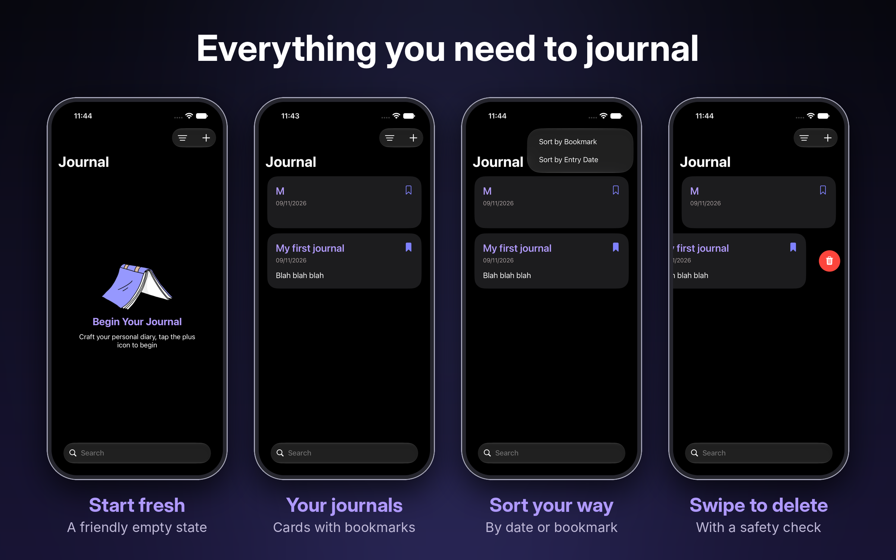

<p align="center">
  
</p>

# 📝 Journali

**Your thoughts, your story.**

Journali is a simple and private journaling app for iPhone. Write your daily thoughts, bookmark your favorite entries, and find any memory quickly with search and sorting.

---

## ✨ Main Features

- ✍️ **Create journals**: write a title and your thoughts in a clean editor
- 📝 **Edit journals**: update any entry, and its date updates automatically
- 🗑️ **Delete with confirmation**: swipe a journal to delete it, with a safety alert
- 🔖 **Bookmark**: mark your favorite journals with one tap
- 🔍 **Search**: find journals by words in the title or the text
- ↕️ **Sort**: by newest entry date or bookmarked first
- 💾 **Saved on your phone**: your journals are still there after closing the app
- 🌙 **Dark design**: a calm dark look with a friendly empty state

---

## 📱 Screenshots

<p align="center">
  
</p>

---

## 🛠️ Tech Stack

- **Swift**
- **SwiftUI**
- **MVVM** architecture (Model, View, ViewModel)
- **Codable + JSON** for saving data locally
- **SF Symbols** for icons
- **Xcode 27.2**
- Runs on **iPhone** (iOS 26 or later)

---

## 🗂️ Project Structure

```
Journali
├── JournaliApp.swift
├── ContentView.swift
├── Theme
│   └── Colors.swift
├── Models
│   └── Journal.swift
├── ViewModels
│   └── JournalViewModel.swift
└── Views
    ├── SplashView.swift
    ├── MainView.swift
    ├── JournalCardView.swift
    ├── EmptyStateView.swift
    └── JournalEditorView.swift
```

---

## ▶️ How to Run

1. Clone or download this repository
2. Open `Journali.xcodeproj` in Xcode
3. Choose an iPhone simulator (for example iPhone 17)
4. Press **Run** (▶)

---

## 👩‍💻 Author

Made by **Waad Al Malki**
GitHub: [@notw3d](https://github.com/notw3d)
